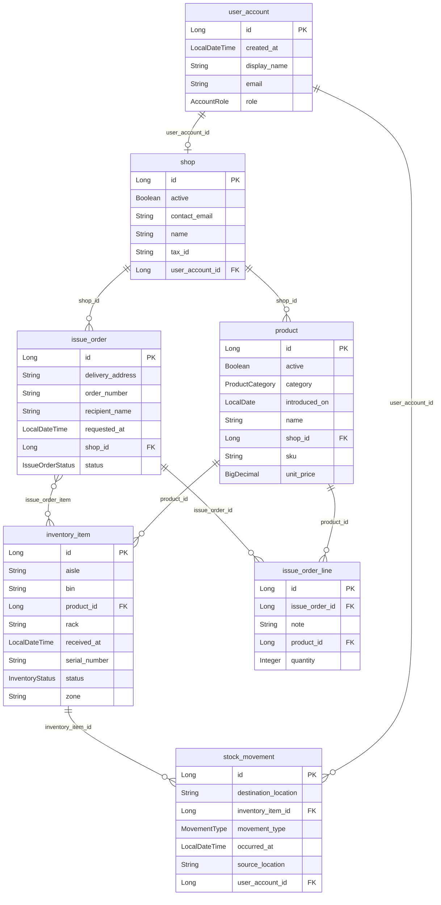

# Schemat bazy danych

Plik generują reguły projektu (panel Maven → Lifecycle → verify). Nie edytujcie go ręcznie.

Tabele: 8 (w tym tabele łączące @ManyToMany: issue_order_item) · kolumny: 47 · relacje: 7 × @ManyToOne, 3 × @OneToMany, 1 × @OneToOne, 1 × @ManyToMany

| Tabela | Encja | Kolumny | Klucze obce |
|---|---|---|---|
| inventory_item | InventoryItem | 9 | product_id |
| issue_order | IssueOrder | 7 | shop_id |
| issue_order_line | IssueOrderLine | 5 | issue_order_id, product_id |
| product | Product | 8 | shop_id |
| shop | Shop | 6 | user_account_id |
| stock_movement | StockMovement | 7 | inventory_item_id, user_account_id |
| user_account | UserAccount | 5 | — |

